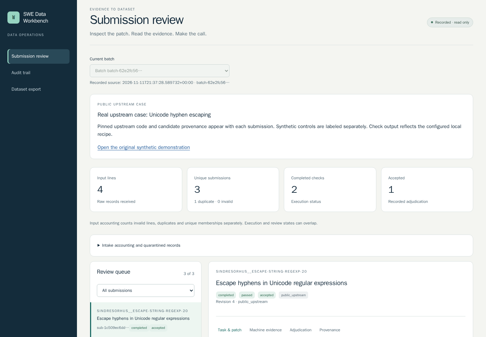

# SWE Data Workbench

**Inspect software changes, test evidence and review decisions as one traceable handoff.**

A passing checker can miss broken code. This working preview demonstrates that failure: a buggy ingestion service scores **100/100** with the original checker, then **50/100 with a failed recovery gate** after the checker is repaired. The same valid repairs and recorded Codex candidate pass both versions.

Open the recorded demonstration:

https://swe-data-workbench.flyswatterghost.chatgpt.site/evaluation-demo/

1. **Compare the checkers.** Find the false pass and see which critical behavior the original checker missed.
2. **Inspect a candidate.** Open its patch and machine evidence to examine the actual checks, output and provenance.
3. **Watch the silent walkthrough.** Use the visible playback controls; it starts paused and muted with captions.

Candidate acceptance remains pending in this example. Passing checks supply evidence for a review decision; the evaluation downloads include every outcome, while the accepted-code export stays empty until acceptance.

The browser shows frozen evidence. The account-free driver below executes the admitted examples and verifies their results. The demonstration uses one authored task, labeled controls and one recorded Codex attempt; its scores measure those named checks.



## Run the coding-task example

Requires Linux, Python 3.12 and Git. From a fresh checkout, install the pinned runtime in a local environment:

```sh
git clone https://github.com/RedRookAI/swe-data-workbench.git
cd swe-data-workbench
python3 -m venv .venv
.venv/bin/python -m pip install -r requirements.lock
.venv/bin/python tools/run_quality_demo.py --root .state/quality-example
```

The driver reconstructs the original source, prepares the bundles, runs the same patches against weak and repaired checkers, replays the explicitly recorded assessments and verifies the exports. It makes no model request. Choose a fresh output root for another run; existing evidence is preserved.

Installable wheel, selected evidence and verification:

https://github.com/RedRookAI/swe-data-workbench/releases/tag/v0.1.0a13

## What is implemented

- **Admitted execution:** run exact selected source/check/patch tuples in separate workspaces, preserve the original source and protect verifier files from ordinary candidate patches.
- **Recoverable processing:** retain launch intent, process identity, generation fences and committed results so interrupted work can be reconciled without silently replacing newer evidence.
- **Evidence-bound review:** tie decisions to exact material, reject stale reviews and retain prior concerns and explicit reviewer attribution.
- **Evaluation and export:** inspect grader findings and criterion credit, preserve failed or missing candidate evidence, and export traceable evaluation datasets separately from explicitly accepted code.
- **Daily handoffs:** capture committed changes with existing pytest/JUnit reports, keep CI process/source/workflow identities separate and export a review another engineer can inspect.

For the ingestion example, the repaired checker interrupts execution after a durable event and examines state before replay. It also checks loss/double-counting, callback exceptions, parsing, CLI behavior and compatibility with an existing successfully saved state. Signed64 aggregate-overflow coverage remains an explicit unmeasured limitation.

## Review your own changes

The complete operator guide covers one project setup, existing reports, inspection, explicit decisions and a fresh export containing the decision. Prepared packages remain frozen after later reviews.

[Follow the daily operator guide](docs/daily-workflow.md)

The GitHub workflow retains actual test output and prepares evidence after passing or failing checks. An intentional failure example demonstrates artifact delivery while CI stays failed. The external example retains an actual historical itsdangerous change with its original attribution.

https://swe-data-workbench.flyswatterghost.chatgpt.site/ci/

The selected source/review examples and missing-evidence control remain available:

https://swe-data-workbench.flyswatterghost.chatgpt.site

## Engineering choices and scope

SQLite provides a local transactional authority for state and audit events. Checks run outside database transactions. Content-addressed artifacts preserve the material behind each result and decision. Check success, evaluation-task approval, handoff readiness and code acceptance are separate states.

This is a Linux/Python preview for trusted, explicitly admitted execution. Separate workspaces and verifier-integrity checks do not isolate arbitrary hostile same-user code. Reports/manifests are unsigned; content consistency does not authenticate a producer. The public site serves selected recorded evidence. Private live review uses an owner token through a trusted connection; setup is documented in the guides.

Project direction and acceptance requirements are owner-led. Implementation, research, debugging, verification, documentation and demonstration preparation used substantial Codex assistance. Recorded model output, upstream human changes, authored controls and scripted decisions retain distinct attribution. Keep supplied prior art for recovery and auditable decisions; the application runs independently.

[Engineering decisions](docs/engineering.md) · [Security boundaries](SECURITY.md) · [Current verification](docs/verification.md) · [Observed operator trial](docs/operator-trial.md)

Profiles, format compatibility and advanced commands are documented in [everyday handoffs](docs/everyday-handoffs.md), [repeatable handoff/restore](docs/reliable-handoffs.md) and [CI evidence](docs/ci-review.md). Earlier prepared, Unicode-hyphen and synthetic examples remain linked from the demonstration, with their original evidence and releases preserved.
